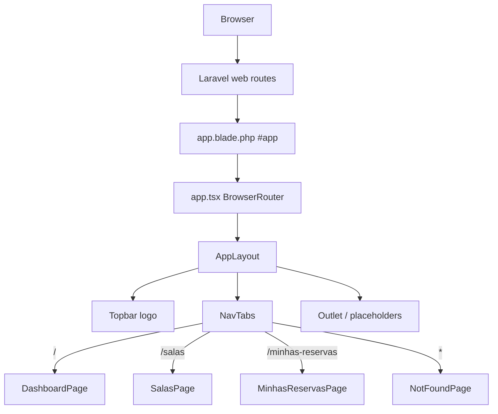

# App Layout Design

**Spec**: `.specs/features/app-layout/spec.md`
**Status**: Ready for task approval

---

## Architecture Overview

The SPA gains a shared chrome shell: CSS design tokens from the mockup, an `AppLayout` (topbar + container + nav), and client-side routes for the three tabs. Laravel serves the same Blade SPA document for deep links so refresh on `/salas` and `/minhas-reservas` still mounts React. Domain page bodies stay placeholders (AD-005).

---

## Code Reuse Analysis

### Existing Components to Leverage

| Component | Location | How to Use |
| --------- | -------- | ---------- |
| SPA Blade shell | `resources/views/app.blade.php` | Keep mount + `@vite`; no chrome in Blade |
| React entry | `resources/js/app.tsx` | Replace `Home` health UI with router + layout |
| Page folder | `resources/js/pages/` | Add Dashboard / Salas / MinhasReservas / NotFound; retire health-only `Home` from the shell |
| Global CSS | `resources/css/app.css` | Add mockup `:root` tokens alongside Tailwind |
| Vite / TS pipeline | `vite.config.js`, `tsconfig.json` | Unchanged; new dependency only for routing |

### Patterns to Follow

- TypeScript React under `resources/js` (AD-004)
- Same-origin SPA (AD-002); no separate frontend package
- PHPUnit feature tests for HTTP contracts; no Dusk (project testing skill)

### New Code Required

| Component | Location | Reason |
| --------- | -------- | ------ |
| Design tokens | `resources/css/app.css` | Mockup CSS variables (user 4.A) |
| `react-router-dom` | `package.json` | Tab ↔ URL sync (user 2.A); not installed today |
| `AppLayout` | `resources/js/components/AppLayout.tsx` | Topbar + container + outlet frame |
| `NavTabs` | `resources/js/components/NavTabs.tsx` | Three tabs with active style |
| Placeholder pages | `resources/js/pages/*.tsx` | Minimal bodies per AD-005 |
| SPA fallback routes | `routes/web.php` | Deep link + unknown path still serve Blade |

---

## Tech Decisions

| Decision | Choice | Alternatives | Why |
| -------- | ------ | ------------ | --- |
| Client router | `react-router-dom` (BrowserRouter) | Manual `history` API | Standard SPA routing; task approval covers the new dependency |
| Tokens | Mockup `:root` CSS variables in `app.css`, consumed by layout classes | Map only into Tailwind `@theme` | Spec lists exact hex values; `:root` matches the binding HTML 1:1 |
| Deep links | Catch-all web view to `app` excluding `/api` | One route per path only | Supports not-found placeholder URLs without new Blade files |
| Health UI | Removed from shell | Keep in a corner | User 5.A; `api.ts` helper remains for later features |

---

## Components

### Design tokens (`resources/css/app.css`)

- **Purpose**: Define `--primary`, `--primary-dark`, `--bg-primary`, `--bg-secondary`, `--text-primary`, `--text-secondary`, `--text-tertiary`, `--border`, `--shadow`, `--shadow-hover` with mockup values; body background `--bg-secondary`
- **Interfaces**: CSS custom properties only
- **Dependencies**: Existing Tailwind import

### `AppLayout`

- **Purpose**: Render topbar (logo `📅 Reserva de Salas`), wrap children in max-width 1200px padded container below nav
- **Location**: `resources/js/components/AppLayout.tsx`
- **Interfaces**: `{ children: React.ReactNode }`
- **Dependencies**: tokens, `NavTabs`

### `NavTabs`

- **Purpose**: Links for Dashboard `/`, Salas `/salas`, Minhas Reservas `/minhas-reservas`; active class from current route
- **Location**: `resources/js/components/NavTabs.tsx`
- **Interfaces**: none (reads router location)
- **Dependencies**: `react-router-dom` `NavLink`

### Placeholder pages

- **Purpose**: Minimal non-domain content inside the outlet; `NotFoundPage` for unknown paths
- **Location**: `resources/js/pages/DashboardPage.tsx`, `SalasPage.tsx`, `MinhasReservasPage.tsx`, `NotFoundPage.tsx`
- **Dependencies**: none beyond layout outlet

### Router bootstrap (`app.tsx`)

- **Purpose**: `BrowserRouter` + routes nested under `AppLayout`; remove health-check shell from the main UI
- **Dependencies**: pages, layout, `react-router-dom`

### Laravel SPA routes (`routes/web.php`)

- **Purpose**: Serve `app` for `/` and non-API paths so client routes work on refresh
- **Interfaces**: HTTP 200 HTML with `#app` mount
- **Dependencies**: existing `app.blade.php`

---

## Data Models

None. No persistence in this feature.

---

## API Contracts

No new API endpoints. Existing `GET /api/health` stays registered; it is not shown in the layout shell.

---

## Visual Design / UI

| Token / element | Value / rule |
| --------------- | ------------ |
| Logo | Exact `📅 Reserva de Salas`, color `--primary` |
| Topbar | `--bg-primary` + `--shadow`, padding per capture |
| Page background | `--bg-secondary` |
| Container | max-width 1200px, horizontal padding 20px |
| Nav tabs | Labels and active underline per `captures/room-booking-layout.html` |
| Body | Placeholder only — no dashboard cards / rooms grid / reservations list (AD-005) |
| ≤768px | Logo + three tabs remain usable (wrap/stack allowed) |

Binding capture: `captures/room-booking-layout.html`

---

## Risks & Concerns

| Risk | Impact | Mitigation |
| ---- | ------ | ---------- |
| Catch-all web route shadows `/api` | API returns HTML | Register API routes first; constrain catch-all so it does not match `api/*`; feature-test `/api/health` still JSON |
| No Dusk / browser test runner | Chrome UI unproven by PHPUnit | Feature tests cover SPA document for deep links; layout/visual ACs proven by walk + `browser captures/*.running.png` |
| New npm dependency | Needs approval | Called out here; approving tasks authorizes adding `react-router-dom` |
| Existing `Home.tsx` health UI conflicts with 5.A | Shell would still show API status | Replace shell with layout routes; keep `services/api.ts` unused by chrome |

---

## Implementation Notes

- Prefer one atomic commit per task after its gate.
- Run `npm run typecheck` and `npm run build` in the Build gate.
- Do not port mockup domain widgets in this feature.
- After implementation, screens sub-agent compares running chrome to the binding capture (frame only; body placeholders expected per AD-005).
