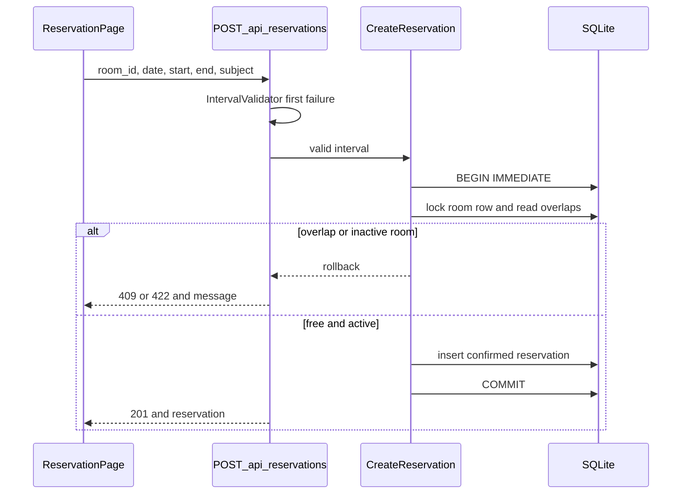
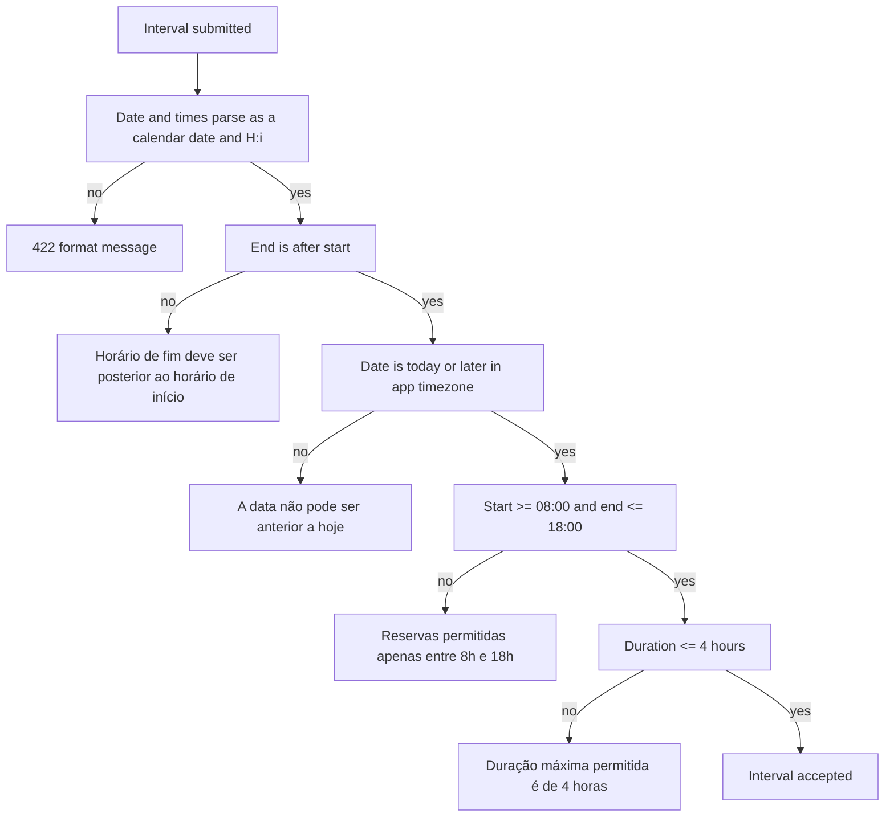

# Salas Design

**Spec**: `.specs/features/salas/spec.md`
**Status**: Approved
**Approved**: 2026-11-06 - user: "Design Aprovado"

---

## Architecture Overview

Laravel owns every rule that changes what the visitor sees: who is listed, the capacity and resource filters, the interval checks, availability, and whether a reservation is stored. React renders the API payload and the server's `message`. It does not decide availability or conflict.

The sqlite connection stays the project default. `lockForUpdate` does not lock on sqlite: `SQLiteGrammar::compileLock` returns `''`. Reservation create still calls `lockForUpdate` so a driver that emits a row lock keeps it. On sqlite, serialization comes from AD-011: `transaction_mode` `IMMEDIATE` and `busy_timeout` `5000`. The second writer waits, then reads the first writer's row and returns HTTP 409.





`App\Reservations\IntervalValidator` is the only place that order lives. List availability and reservation create both call it. Limits come from `config/reservas.php`: `opens_at` `08:00`, `closes_at` `18:00`, `max_duration_minutes` `240`. "Today" is `Carbon::today(config('app.timezone'))`.

Where tests reach the rules: Pest feature tests call the HTTP API with `RefreshDatabase`. The card grid is not asserted from a Blade mount. There is no frontend test runner in `package.json`. The screen check for `captures/salas-list.html` stays on the browser walk in execute.

---

## Code Reuse Analysis

### Existing Components to Leverage

| Component | Location | How to Use |
| --------- | -------- | ---------- |
| JSON API routing | `bootstrap/app.php`, `routes/api.php` | Add room and reservation routes on the existing `/api` prefix. `api/*` already renders exceptions as JSON |
| Fetch helper | `resources/js/services/api.ts` | Grow this file into `api()` plus room and reservation calls. Keep `Accept: application/json` |
| Shell and Salas tab | `resources/js/app.tsx`, `resources/js/components/NavTabs.tsx` | New pages render under `Shell`. The Salas tab already uses `end: false`, so nested `/salas/...` paths stay active |
| Page tone | `resources/js/pages/DashboardPage.tsx` | Reuse the same text and surface tokens. Do not add a second color system |
| Pest feature tests | `tests/Pest.php`, `phpunit.xml` | Same `pest()->extend(TestCase::class)->in('Feature')`. Salas tests opt into `RefreshDatabase`. The suite already uses sqlite `:memory:` |
| Artisan generators | Laravel 13 | `make:model`, `make:request`, `make:controller --api`, `make:resource`, `make:test --pest`, `make:class` |

### Integration Points

| System | Integration Method |
| ------ | ------------------ |
| HTTP API | Public JSON. No auth middleware. Form request `authorize()` returns `true` |
| Database | New `rooms`, `room_resources`, and `reservations` tables. No change to `users` |
| SPA | React Router pages call `/api` on the same origin |

---

## Components

### Room and reservation schema

- **Purpose**: Store rooms, their resource tags, and confirmed or non-confirmed reservations.
- **Location**: migrations under `database/migrations/`, models `app/Models/Room.php`, `app/Models/RoomResource.php`, `app/Models/Reservation.php`
- **Interfaces**:
  - `Room::resources(): HasMany` - tag rows for that room
  - `Room::reservations(): HasMany` - reservations for that room
  - `Reservation::room(): BelongsTo`
- **Dependencies**: sqlite with foreign keys already enabled
- **Reuses**: Eloquent factories, `$fillable`, casts for `active` boolean and `date`

`rooms`: `id`, `name` string 100, `capacity` unsigned small integer, `active` boolean default true, timestamps.

`room_resources`: `id`, `room_id` foreign key cascade on delete, `name` string, `name_normalized` string. Unique `(room_id, name_normalized)`. The product has no delete control. Cascade only covers a future schema delete.

`reservations`: `id`, `room_id` foreign key restrict on delete, `date` date, `starts_at` char(5), `ends_at` char(5), `subject` string 200, `status` string default `confirmed`, timestamps. Index `(room_id, date, status)`.

Times are zero-padded `H:i`, so string comparison matches clock order.

### IntervalValidator

- **Purpose**: Return the first interval failure, or accept the interval.
- **Location**: `app/Reservations/IntervalValidator.php`
- **Interfaces**:
  - `firstFailure(string $date, string $start, string $end): ?string` - spec message, or `null` when the interval passes
- **Dependencies**: `config/reservas.php`, `config('app.timezone')`
- **Reuses**: nothing yet. Both the list query and `CreateReservation` call this class

### CreateReservation

- **Purpose**: Revalidate the room and the conflict inside one transaction and insert one confirmed row, or store nothing.
- **Location**: `app/Reservations/CreateReservation.php`
- **Interfaces**:
  - `handle(Room $room, string $date, string $start, string $end, string $subject): Reservation`
- **Dependencies**: `IntervalValidator`, `DB::transaction`, `lockForUpdate`
- **Reuses**: the room model

Inside the transaction the action locks the room row, refuses an inactive room with `Sala inativa não permite nova reserva` (HTTP 422), refuses an overlap of a `confirmed` reservation with `Conflito de horário` (HTTP 409), and inserts `status = confirmed`. A non-confirmed row does not overlap. An endpoint touch (`end == other start`) does not overlap: `starts_at < $end` and `ends_at > $start`.

A domain exception carries the status and the spec message. Its `render` method returns JSON `{ "message": "..." }`. It implements `ShouldntReport`. The transaction rolls back before the response, including when the exception is thrown inside the closure.

### Room query

- **Purpose**: Apply minimum capacity, resource, and optional availability in the database.
- **Location**: `app/Rooms/ListRooms.php`
- **Interfaces**:
  - `handle(array $filters): Collection` - rooms eager-loaded with `resources`, each active room marked `disponivel` or `indisponivel` when an interval was supplied
- **Dependencies**: `IntervalValidator`
- **Reuses**: `Room` and `RoomResource`

`min_capacity` filters `capacity >= n`. `resource` trims and matches `name_normalized`. Blank filters return every room. Inactive rooms stay in the list with `availability: null`.

### HTTP layer

- **Purpose**: Validate input shape, delegate the rule, return one JSON message.
- **Location**: `app/Http/Controllers/RoomController.php`, `app/Http/Controllers/RoomActivationController.php`, `app/Http/Controllers/ReservationController.php`, form requests under `app/Http/Requests/`, `app/Http/Resources/RoomResource.php`, `app/Http/Resources/ReservationResource.php`
- **Interfaces**:
  - `GET /api/rooms` - 200 and `{ "data": [ RoomResource ] }`. Query: `min_capacity`, `resource`, `date`, `start`, `end`. A partial interval or a failed `IntervalValidator` returns 422 and does not include availability flags
  - `POST /api/rooms` - 201 and the room resource
  - `GET /api/rooms/{room}` - 200, or 404 `{ "message": "Sala não encontrada" }`
  - `PUT /api/rooms/{room}` - 200 and the updated room
  - `POST /api/rooms/{room}/activate` and `POST /api/rooms/{room}/inactivate` - 200 and the room. Inactivate does not delete reservations
  - `POST /api/reservations` - 201 `{ "data": ReservationResource }`, 409 on conflict, 422 on invalid interval, inactive room, or subject, 404 when `room_id` is missing
- **Dependencies**: actions above
- **Reuses**: `Route::apiResource('rooms', RoomController::class)->except('destroy')` plus the two activation routes and `reservations.store`

There is no `DELETE`. `authorize()` on every form request returns `true`.

Validation messages are the spec strings, not Laravel's English defaults. The 422 body is `{ "message": "<spec text>", "errors": { "<field>": ["<spec text>"] } }`. The UI shows `message`.

Shape rules, before `IntervalValidator`:

| Input | Message |
| ----- | ------- |
| Room name empty | `Informe o nome da sala` |
| Room name longer than 100 | `O nome da sala deve ter no máximo 100 caracteres` |
| Capacity not an integer from 1 to 999 | `A capacidade deve ser um número inteiro de 1 a 999` |
| Subject empty | `Informe o assunto` |
| Subject longer than 200 | `O assunto deve ter no máximo 200 caracteres` |
| Date or time missing or not parseable | `Informe data e horários válidos` |

`Informe data e horários válidos` covers input that cannot enter the ordered business checks. Once the values parse, only `IntervalValidator` picks the message.

Resource names are trimmed. The write path keeps the first spelling for a case-insensitive duplicate and drops the rest. Empty names are dropped. Omitted `resources` stores no tag rows. `active` defaults to `true` on create when omitted.

### React pages

- **Purpose**: Show the spec copy and send the visitor's input to the API.
- **Location**: `resources/js/pages/SalasPage.tsx`, `RoomFormPage.tsx`, `RoomDetailPage.tsx`, `ReservationPage.tsx`, routes in `resources/js/app.tsx`
- **Interfaces**:
  - `/salas` - list, filters, availability query
  - `/salas/nova` - create form, opened by `Nova sala`
  - `/salas/:id` - detail, `Reservar` only when `active` is true, `Editar`, `Ativar` or `Inativar`
  - `/salas/:id/editar` - edit form filled from `GET /api/rooms/:id`
  - `/salas/:id/reservar` - reservation page with that room selected
- **Dependencies**: `resources/js/services/api.ts`
- **Reuses**: `Shell`, existing tokens

`api()` throws `ApiError` with `status` and `message` from the JSON body. Pages map that message onto the spec text. They do not reimplement the interval order.

List states: `Carregando salas...`, `Nenhuma sala cadastrada`, `Nenhuma sala encontrada`, `Não foi possível carregar as salas` plus `Tentar novamente`. A 422 from `Filtrar` or `Consultar disponibilidade` leaves the previous cards on screen, hides `Disponível` and `Indisponível`, and shows the message. Detail uses `Carregando sala...`, `Sala não encontrada`, and `Não foi possível carregar a sala`. Save and create failures use `Não foi possível salvar a sala` and `Não foi possível criar a reserva` only when the status is not 422, 404, or 409.

The card uses the capture's composition: name, `Capacidade: N pessoas`, one tag per resource, `Ativa` or `Inativa`. Wider than 768px: 3 columns. At 768px and below: 1 column. The heading is `Salas`. A long list scrolls with the page.

After HTTP 201 on a reservation, the page shows `Reserva criada com sucesso!` and does not navigate away.

---

## Data Models

### Room

```typescript
interface Room {
  id: number
  name: string
  capacity: number
  resources: string[]
  active: boolean
  availability: 'disponivel' | 'indisponivel' | null
}
```

**Relationships**: one room has many `room_resources` and many `reservations`. `availability` is computed for the request. It is not a column.

### Reservation

```typescript
interface Reservation {
  id: number
  room_id: number
  date: string
  starts_at: string
  ends_at: string
  subject: string
  status: 'confirmed' | 'unconfirmed'
}
```

**Relationships**: belongs to one room. This feature only inserts `confirmed`. Tests may insert `unconfirmed` to prove it does not block.

---

## Error Handling Strategy

| Error Scenario | Handling | User Impact |
| -------------- | -------- | ----------- |
| Invalid field or interval | `ValidationException` or `IntervalValidator`, HTTP 422, one spec `message` | The form or the list shows that sentence. No row is written. Availability labels clear |
| Unknown room | Missing route model becomes HTTP 404 `{ "message": "Sala não encontrada" }` | The detail or the reservation page shows that sentence |
| Overlapping confirmed reservation | Domain exception, rollback, HTTP 409 `{ "message": "Conflito de horário" }` | The reservation page shows that sentence. One confirmed row at most |
| Inactive room on create | Domain exception, rollback, HTTP 422 `Sala inativa não permite nova reserva` | No new reservation |
| sqlite writer waited out `busy_timeout` | Let the transaction fail, store nothing, HTTP 500 is caught at the reservation boundary and returned as `Não foi possível criar a reserva` | The page shows the generic failure. No partial row |
| List or detail network/server failure | Non-422 response | `Não foi possível carregar as salas` or `Não foi possível carregar a sala`, with `Tentar novamente` |
| Anonymous caller | No auth middleware | The same success and error codes as a request with cookies |

---

## Risks & Concerns

| Concern | Location | Impact | Mitigation |
| ------- | -------- | ------ | ---------- |
| `lockForUpdate` compiles to nothing on sqlite | `vendor/laravel/framework/src/Illuminate/Database/Query/Grammars/SQLiteGrammar.php:31` | Two deferred transactions can both pass the overlap read and both insert | AD-011: `IMMEDIATE` plus `busy_timeout` 5000. The overlap read stays inside that transaction |
| True concurrency is invisible to one in-process HTTP call | `tests/Pest.php`, `phpunit.xml` `DB_DATABASE=:memory:` | A sequential second POST proves overlap, not CA07 | One Pest test runs two PHP processes against one sqlite file and expects one 201 and one 409. Other tests keep `:memory:` |
| No frontend test runner | `package.json` | A Pest test cannot see the 3-column card | Do not add Playwright in this feature. HTTP tests lock payloads and messages. The execute browser walk judges `captures/salas-list.html` |
| Unbounded room list | `GET /api/rooms` | A huge catalog would load in one response | This demo has no paging requirement. The query eager-loads `resources` once |
| `RefreshDatabase` is commented out | `tests/Pest.php:17` | A new test that forgets the trait hits a database with no tables | Salas feature tests declare `uses(RefreshDatabase::class)` in their file |
| Global `IMMEDIATE` transactions | `config/database.php` sqlite `transaction_mode` | A long transaction blocks other sqlite writers | The reservation transaction only locks for the read-and-insert. Recorded as AD-011 so later features do not switch the mode back to `DEFERRED` |
| JSON 404 copy | `bootstrap/app.php` exception render | Laravel's default missing-model JSON is not `Sala não encontrada` | Render `ModelNotFoundException` for `Room` on `api/*` with that message |

---

## Tech Decisions

| Decision | Choice | Rationale |
| -------- | ------ | --------- |
| Rule owner | Laravel API, React displays | User chose this approach |
| sqlite concurrency | `IMMEDIATE` and `busy_timeout` 5000, plus `lockForUpdate` inside `DB::transaction` | AD-011. `compileLock` is empty on sqlite |
| Resource storage | `room_resources` rows, not a JSON column | Case-insensitive unique tags and the filter are normal SQL. Works beyond sqlite `json_each` |
| Interval rules | One `IntervalValidator`, shared config | The spec requires one order and the same limits on query and create |
| List and availability | One `GET /api/rooms` | User did not choose a second endpoint. Flags appear only when the interval is valid |
| Activation | `POST .../activate` and `POST .../inactivate` | Not a delete, and not an overload of `PUT` that would hide the gesture |
| Tests | Pest HTTP tests, `RefreshDatabase` per salas file | The suite is already Pest. Rules must run where those tests reach |
| Screen proof | Browser walk against the capture, no new test dependency | `package.json` has no component runner. Project rule: do not add dependencies without approval |

Project-level decision AD-011 is in `.specs/STATE.md`. The other rows stay in this feature.
