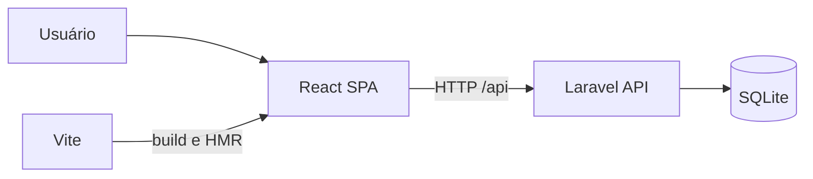
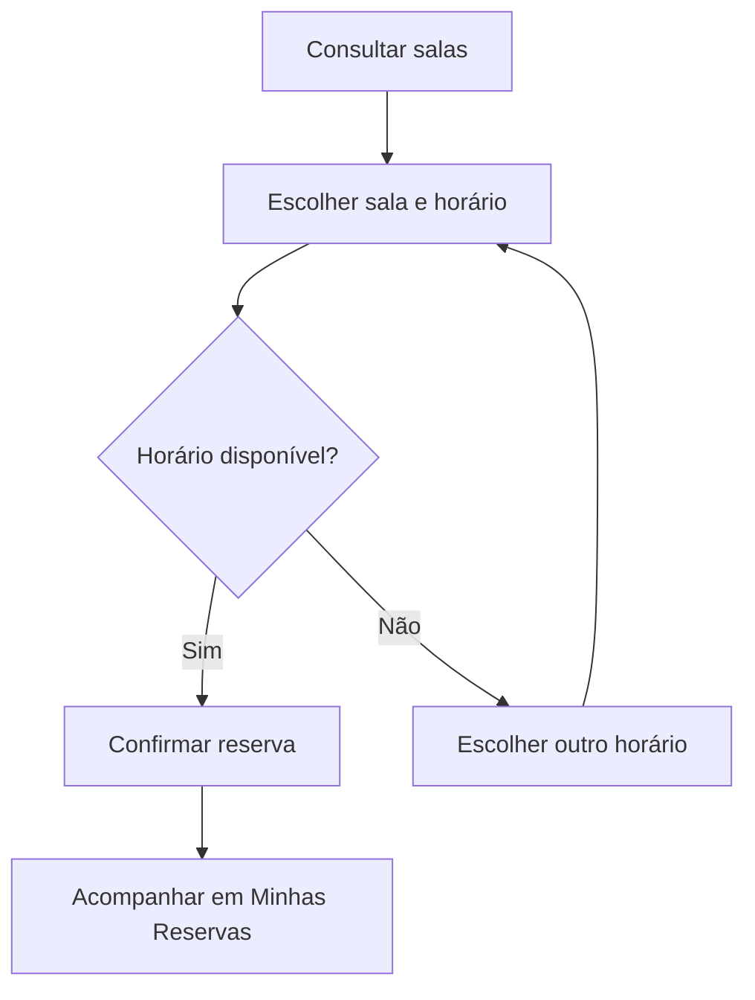

# 📅 Agenda SDD

Aplicação web para consultar salas, acompanhar a agenda e gerenciar reservas de
ambientes. O projeto usa Laravel como backend e uma SPA em React no frontend.

> **Estado atual:** a estrutura da SPA, a navegação principal e o endpoint de
> saúde da API estão implementados. Os fluxos completos de salas e reservas
> ainda estão em desenvolvimento.

## Visão geral

A interface está organizada em três áreas:

- **Dashboard:** visão geral das reservas e salas disponíveis;
- **Salas:** consulta dos ambientes e de seus recursos;
- **Minhas Reservas:** acompanhamento e gerenciamento das reservas do usuário.

## Arquitetura



O Laravel entrega o shell da aplicação e mantém as rotas da API. O React Router
controla a navegação no navegador, enquanto o Vite compila os arquivos
TypeScript e CSS.

## Tecnologias

- PHP 8.3+ e Laravel 13;
- React 19 e React Router 7;
- TypeScript 7;
- Tailwind CSS 4;
- Vite 8;
- SQLite;
- Pest 5.

## Requisitos

Antes de começar, instale:

- PHP 8.3 ou superior;
- Composer;
- Node.js e npm;
- extensões do PHP exigidas pelo Laravel e pelo SQLite.

## Instalação

O script de setup instala as dependências, prepara o `.env`, gera a chave da
aplicação, executa as migrations e compila o frontend:

```bash
git clone <url-do-repositorio>
cd agenda-sdd
composer run setup
```

Por padrão, o projeto usa SQLite. Caso o arquivo do banco ainda não exista:

```bash
touch database/database.sqlite
php artisan migrate
```

## Executando localmente

Inicie o ambiente de desenvolvimento:

```bash
composer run dev
```

O comando inicia os serviços de desenvolvimento do Laravel e do frontend. A URL
da aplicação é definida por `APP_URL` no arquivo `.env`.

Para executar apenas o frontend com hot reload:

```bash
npm run dev
```

## Rotas disponíveis

| Método | Caminho | Descrição |
| --- | --- | --- |
| `GET` | `/` | Dashboard da aplicação |
| `GET` | `/salas` | Lista de salas |
| `GET` | `/minhas-reservas` | Reservas do usuário |
| `GET` | `/api/health` | Verificação de saúde da API |

As rotas da interface retornam o mesmo shell React. Endereços desconhecidos sob
`/api` mantêm a resposta JSON padrão da API.

## Fluxo planejado de reserva



## Comandos úteis

```bash
# Executar os testes
composer test

# Verificar os tipos TypeScript
npm run typecheck

# Gerar os arquivos de produção
npm run build

# Formatar o código PHP
vendor/bin/pint
```

## Estrutura principal

```text
app/                    Backend e regras da aplicação
database/               Migrations, factories e seeders
resources/js/           SPA React, páginas, componentes e serviços
resources/css/          Estilos globais
resources/views/        Shell Blade que hospeda a SPA
routes/api.php          Endpoints da API
routes/web.php          Entrada e fallback da interface
tests/                  Testes automatizados com Pest
```

## Qualidade

Antes de enviar alterações, execute:

```bash
composer test
npm run typecheck
npm run build
```

## Próximas etapas

- cadastrar e listar salas;
- criar, consultar e cancelar reservas;
- impedir conflitos de horário;
- adicionar autenticação e associar reservas aos usuários;
- apresentar indicadores reais no dashboard.

## Licença

Este projeto está disponível sob a licença [MIT](https://opensource.org/licenses/MIT).
